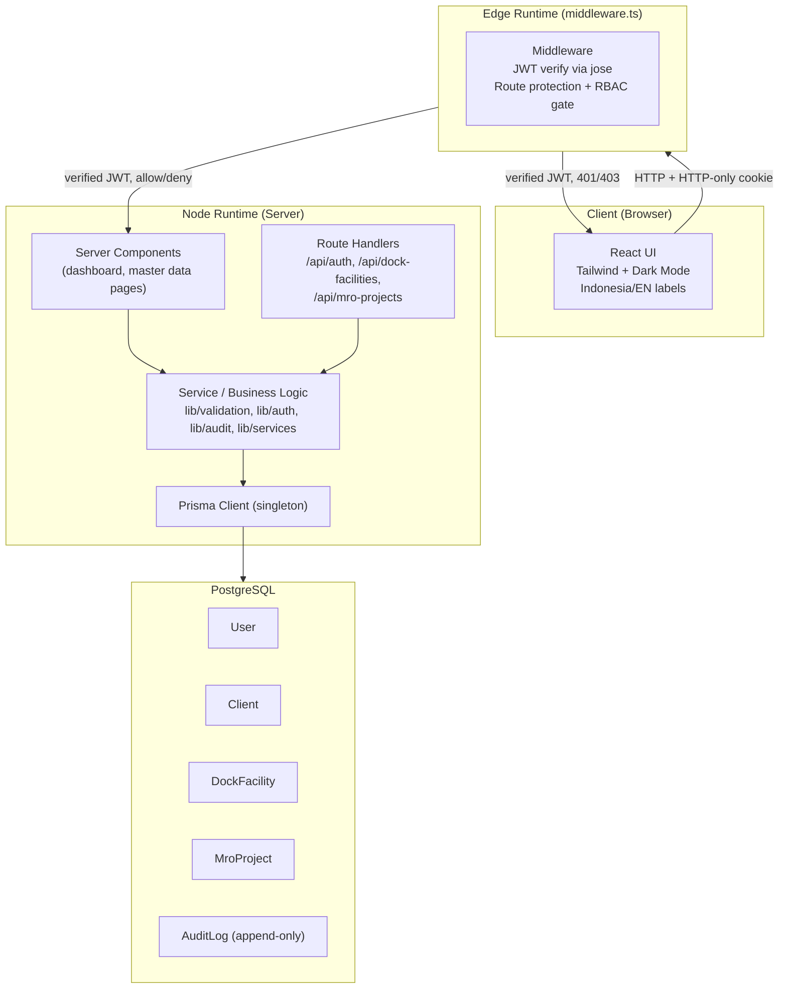
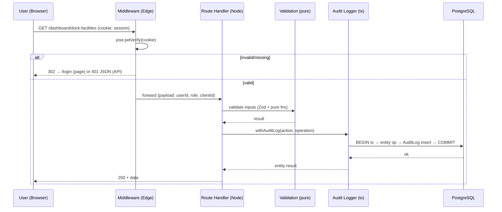
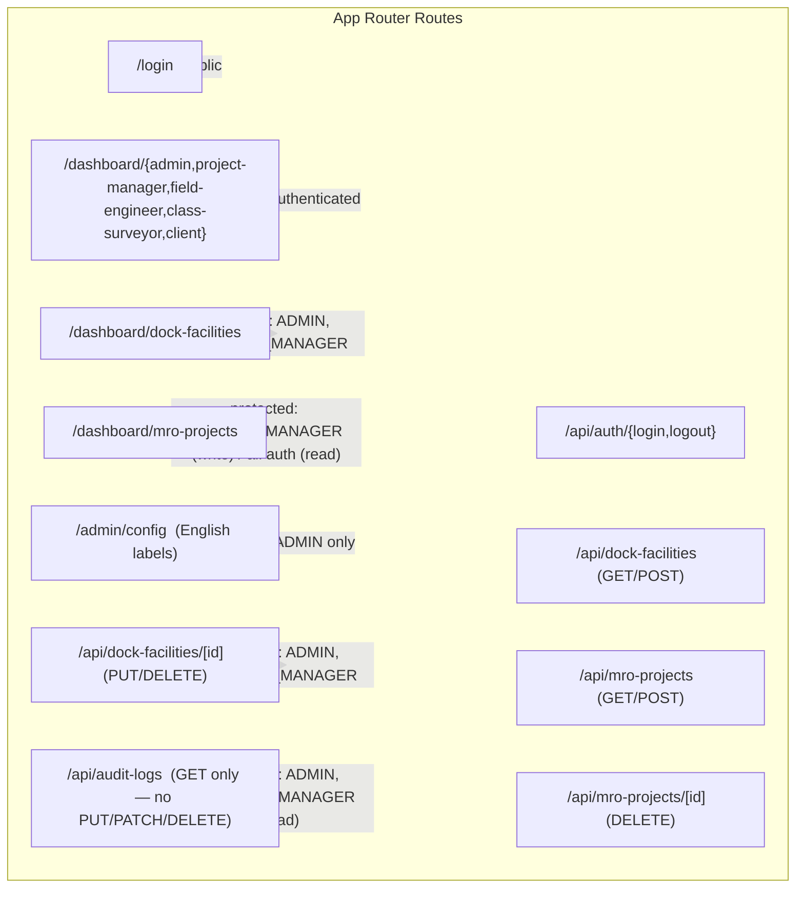
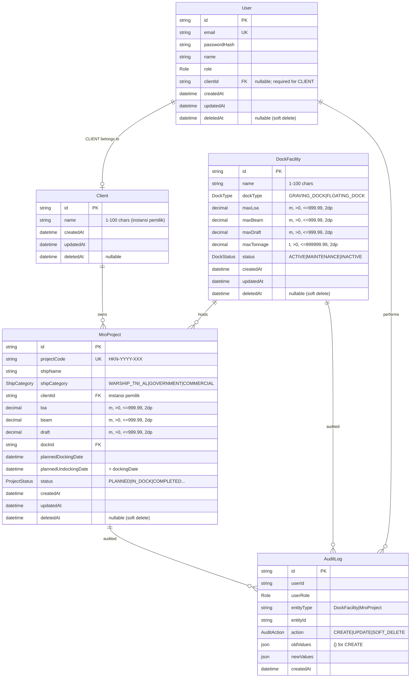

# Design Document — SMART-HARKAN Foundation

## Overview

This design covers **Stage 1 — System Foundation, RBAC & Master Data** of the PAL-MRO Integrated Portal (SMART-HARKAN) for PT PAL Indonesia's Harkan Division. It defines the technical architecture, data models, RBAC and authentication, validation logic, immutable audit trail, and maritime UI/UX for the foundation upon which later stages (Dock Capacity Planner, Digital Repair List & E-Surveyor, S-Curve Monitoring, Client Portal, Material Readiness Tracker) will build.

The design is driven by five requirement groups:

1. **Architecture & Maritime UI Standard** — Next.js App Router, TypeScript strict, Tailwind, responsive 360–1280px, maritime palette, Dark Mode, Indonesia-primary / English-admin language convention.
2. **RBAC** — encrypted session (HTTP-only cookie / JWT), role-based route protection, client data isolation.
3. **Dock Facility Master Data** — CRUD with dimension/tonnage validation, soft delete protected against active in-dock projects.
4. **MRO Project Master Data & Dock Capacity Validation** — project registration with automated ship-vs-dock dimension validation, date ordering, project code format/uniqueness, dock active-status gate.
5. **Immutable Audit Trail** — atomic, append-only audit logging of CREATE/UPDATE/SOFT_DELETE on `DockFacility` and `MroProject`, with transactional rollback on audit-write failure.

### Design Decisions and Rationale

| Decision | Choice | Rationale |
|---|---|---|
| Framework | Next.js (App Router) + TypeScript strict mode | Requirement 1.1 mandates it; App Router gives server components, route handlers, and edge middleware. |
| Styling | Tailwind CSS (class-based, no inline styles) | Requirement 1.1 mandates Tailwind and forbids inline `style` attributes; class strategy enables Dark Mode. |
| Database | PostgreSQL | Native `JSON`/`JSONB` columns for `AuditLog.old_values`/`new_values`; check constraints for dimensions/tonnage; mature, reliable. |
| ORM / Query Layer | Prisma | Mature TypeScript type safety, migrations, JSON-column support, soft-delete via `deletedAt`, interactive transactions for atomic audit logging. Prisma runs in Server Components / Route Handlers (Node runtime); middleware never touches the DB. |
| JWT signing/verification | `jose` | Next.js middleware runs on the **Edge Runtime**, which does not support Node's `crypto`. `jose` uses the Web Crypto API and is the standard Edge-compatible JWT library; `jsonwebtoken` fails in middleware. |
| Password hashing | `bcryptjs` (or `argon2`) | Industry-standard adaptive hashing; run in Server Components / Route Handlers (Node runtime), not middleware. |
| Schema validation | Zod | TypeScript-first schemas with inferred types; reusable across API route handlers, server actions, and client forms (with `react-hook-form`). |
| Testing framework | Vitest | Fast, ESM-native, first-class Next.js/TS support; pairs with `fast-check`. |
| Property-based testing | `fast-check` (+ `@fast-check/vitest`) | Standard PBT library for TS; the validation logic in this stage is pure functions over large numeric/string input spaces — an ideal PBT fit. |

---

## Architecture

### High-Level Architecture

The System is a single Next.js application with four logical layers. The Edge middleware performs only JWT verification (no DB access); all database work happens in Server Components and Route Handlers running on the Node runtime.



### Request Flow



### Routing Structure (App Router)



---

## Components and Interfaces

### 1. Middleware (Edge) — `middleware.ts`

Runs only JWT verification and route authorization. Never imports Prisma or any Node-only module.

```typescript
// middleware.ts (conceptual signature)
import { NextRequest, NextResponse } from 'next/server';
import { jwtVerify } from 'jose';

const PUBLIC_PATHS = ['/login'];
const AUTH_API_PREFIXES = ['/api/auth'];
const ADMIN_MASTER_PATHS = ['/admin/config', '/api/dock-facilities', '/dashboard/dock-facilities'];

interface SessionPayload {
  userId: string;
  role: 'ADMIN' | 'PROJECT_MANAGER' | 'FIELD_ENGINEER' | 'CLASS_SURVEYOR' | 'CLIENT';
  clientId?: string; // present only for CLIENT role
}

export async function middleware(request: NextRequest): Promise<NextResponse>;
export const config = { matcher: ['/dashboard/:path*', '/api/:path*', '/admin/:path*'] };
```

**Middleware logic:**
1. If path is public (`/login`) or under `/api/auth/*` → `NextResponse.next()`.
2. Read `session` cookie; `jose.jwtVerify(token, secret, { algorithms: ['HS256'] })`.
   - On failure: if `/api/*` → `401 Unauthorized` JSON; else → `302` redirect to `/login`.
3. Role authorization:
   - If path is an admin/master-data path and role is `CLIENT`, `FIELD_ENGINEER`, or `CLASS_SURVEYOR` → if `/api/*` return `403 Forbidden` JSON; else redirect to `/forbidden` (or `/dashboard/{role}`).
   - If path is `/admin/config` and role is not `ADMIN` → `403` / forbidden.
4. Otherwise → `NextResponse.next()`.

### 2. Authentication — `lib/auth/session.ts`

```typescript
import { SignJWT, jwtVerify } from 'jose';

const secret = new TextEncoder().encode(process.env.JWT_SECRET!); // ≥ 256-bit

// Issue a session: sign JWT, set HTTP-only cookie
export async function createSession(payload: SessionPayload): Promise<string>;
// payload: { userId, role, clientId? }, exp 8h, iss 'smart-harkan', alg HS256

// Verify and decode a JWT (used in middleware and server-side)
export async function verifySession(token: string): Promise<SessionPayload | null>;

// Cookie config
export const SESSION_COOKIE = 'session';
// { httpOnly: true, secure: prod, sameSite: 'lax', path: '/', maxAge: 8h }
```

### 3. RBAC — `lib/auth/rbac.ts`

```typescript
export type Role = 'ADMIN' | 'PROJECT_MANAGER' | 'FIELD_ENGINEER' | 'CLASS_SURVEYOR' | 'CLIENT';

export const ROLE_DASHBOARD: Record<Role, string> = {
  ADMIN: '/dashboard/admin',
  PROJECT_MANAGER: '/dashboard/project-manager',
  FIELD_ENGINEER: '/dashboard/field-engineer',
  CLASS_SURVEYOR: '/dashboard/class-surveyor',
  CLIENT: '/dashboard/client',
};

const MASTER_DATA_ROLES: Role[] = ['ADMIN', 'PROJECT_MANAGER'];
const ADMIN_ONLY_ROLES: Role[] = ['ADMIN'];

// Pure predicate: can this role access this path?
export function canAccess(role: Role, path: string): boolean;
// - /admin/config → role in ADMIN_ONLY_ROLES
// - master-data paths (dock facilities mgmt, audit read) → role in MASTER_DATA_ROLES
// - other /dashboard/* → any authenticated role
// - CLIENT write to dock/projects → false (read-only)

export function isMasterDataRole(role: Role): boolean; // role in MASTER_DATA_ROLES
export function isAdminRole(role: Role): boolean;      // role in ADMIN_ONLY_ROLES
```

### 4. Validation — `lib/validation/` (pure functions)

These are the core PBT targets. All messages are in Bahasa Indonesia.

```typescript
// lib/validation/dimensions.ts
export interface FieldError { field: string; message: string; }      // message: Indonesian
export interface ValidationResult<T = unknown> {
  valid: boolean;
  errors: FieldError[];
  value?: T;
}

// Dimension bounds (meters): positive, > 0, <= 999.99, max 2 decimals
export const DIMENSION_MAX = 999.99;
export const TONNAGE_MAX = 999999.99;

// Validate a single dimension (loa/beam/draft). Identifies the exact field on failure.
export function validateDimension(value: number, field: 'loa' | 'beam' | 'draft' | 'max_loa' | 'max_beam' | 'max_draft'): ValidationResult;

// Validate tonnage (metric tons): positive, > 0, <= 999999.99, max 2 decimals
export function validateTonnage(value: number, field: 'max_tonnage'): ValidationResult;

// Has at most 2 decimal places?
export function hasAtMostTwoDecimals(value: number): boolean;
```

```typescript
// lib/validation/dock-capacity.ts
export interface ShipDimensions { loa: number; beam: number; draft: number; }
export interface DockLimits { name: string; maxLoa: number; maxBeam: number; maxDraft: number; }

export interface CapacityResult {
  valid: boolean;
  exceededDimensions: Array<'loa' | 'beam' | 'draft'>; // exactly the dims where ship > max
  message: string; // Indonesian, names the specific exceeded dimension(s)
}

// Passes iff loa <= maxLoa AND beam <= maxBeam AND draft <= maxDraft.
// On failure, lists exactly the dimensions that exceed their limit.
export function validateDockCapacity(ship: ShipDimensions, dock: DockLimits): CapacityResult;
```

```typescript
// lib/validation/dates.ts
export interface DateOrderResult { valid: boolean; message: string; }

// Accepts iff plannedUndockingDate > plannedDockingDate (strictly later).
export function validateDateOrder(plannedDockingDate: Date, plannedUndockingDate: Date): DateOrderResult;
```

```typescript
// lib/validation/project-code.ts
export const PROJECT_CODE_REGEX = /^HKN-\d{4}-\d{3}$/;

export interface ProjectCodeResult { valid: boolean; message: string; }

// Format check: HKN-YYYY-XXX (e.g. HKN-2025-001)
export function validateProjectCodeFormat(code: string): ProjectCodeResult;

// Uniqueness predicate (DB-backed, async)
export async function isProjectCodeUnique(code: string, excludeId?: string): Promise<boolean>;
```

```typescript
// lib/validation/dock-status.ts
export type DockStatus = 'ACTIVE' | 'MAINTENANCE' | 'INACTIVE';

// New project creation requires the dock to be ACTIVE.
export function isDockAcceptingNewProjects(dock: { status: DockStatus }): boolean;
```

```typescript
// lib/validation/dock-delete.ts
export type ProjectStatus = 'PLANNED' | 'IN_DOCK' | 'COMPLETED' | string;

// Soft-deleting a dock is blocked iff any of its projects is IN_DOCK.
export function canDeleteDock(projectsOnDock: Array<{ status: ProjectStatus }>): boolean;
```

### 5. Audit Logger — `lib/audit/audit-logger.ts`

Atomic, append-only audit logging. Wraps a business operation and its audit-entry write in a single Prisma interactive transaction so that an audit-write failure rolls back the business operation (Requirement 5.3).

```typescript
import type { PrismaClient, Prisma } from '@prisma/client';

export type AuditAction = 'CREATE' | 'UPDATE' | 'SOFT_DELETE';
export type AuditableEntityType = 'DockFacility' | 'MroProject';

export interface AuditContext {
  userId: string;
  userRole: Role;
}

interface WithAuditLogOptions<T> {
  entityType: AuditableEntityType;
  entityId: string;
  action: AuditAction;
  context: AuditContext;
  oldValues?: Record<string, unknown>; // pre-op snapshot (empty for CREATE)
  // The operation to run inside the transaction; must return the post-op entity.
  operation: (tx: Prisma.TransactionClient) => Promise<T>;
  // Serialize entity for new_values (default: JSON.stringify of returned entity)
  serialize?: (entity: T) => Record<string, unknown>;
}

// Runs operation and AuditLog insert in one transaction.
// On any failure (incl. AuditLog insert), the transaction rolls back and an error is thrown.
export async function withAuditLog<T>(
  options: WithAuditLogOptions<T>
): Promise<T>;
```

**Implementation sketch:**

```typescript
export async function withAuditLog<T>(opts: WithAuditLogOptions<T>): Promise<T> {
  return prisma.$transaction(async (tx) => {
    const newEntity = await opts.operation(tx);            // CREATE/UPDATE/SOFT_DELETE
    const newValues = opts.serialize ? opts.serialize(newEntity) : (newEntity as unknown as Record<string, unknown>);
    await tx.auditLog.create({
      data: {
        userId: opts.context.userId,
        userRole: opts.context.userRole,
        entityType: opts.entityType,
        entityId: opts.entityId,
        action: opts.action,
        oldValues: opts.oldValues ?? {},                    // {} for CREATE
        newValues,
        createdAt: new Date(),
      },
    });
    return newEntity;                                       // commit only if both succeed
  });
}
```

### 6. Services — `lib/services/`

Thin orchestration over Prisma + validation + audit. Client data isolation lives here.

```typescript
// lib/services/mro-projects.ts
export interface SessionUser { userId: string; role: Role; clientId?: string; }

// CLIENT isolation: filter by clientId for CLIENT role (Requirement 2.4)
export async function listProjectsForUser(user: SessionUser): Promise<MroProjectDto[]>;

// Create with full validation + capacity + atomic audit
export async function createMroProject(
  user: SessionUser, input: CreateMroProjectInput
): Promise<{ ok: true; project: MroProjectDto } | { ok: false; errors: FieldError[] }>;

export async function softDeleteMroProject(user: SessionUser, id: string): Promise<...>;
```

```typescript
// lib/services/dock-facilities.ts
export async function listDockFacilities(): Promise<DockFacilityDto[]>;
export async function createDockFacility(user, input): Promise<...>;
export async function updateDockFacility(user, id, input): Promise<...>;
export async function softDeleteDockFacility(user, id): Promise<
  { ok: true } | { ok: false; message: string }  // blocked if active IN_DOCK project
>;
```

### 7. Prisma Client Singleton — `lib/db.ts`

```typescript
import { PrismaClient } from '@prisma/client';
const globalForPrisma = globalThis as unknown as { prisma?: PrismaClient };
export const prisma = globalForPrisma.prisma ?? new PrismaClient();
if (process.env.NODE_ENV !== 'production') globalForPrisma.prisma = prisma;
```

---

## Data Models

### Entity Relationship



### Prisma Schema (`prisma/schema.prisma`)

```prisma
generator client { provider = "prisma-client-js" }
datasource db { provider = "postgresql"; url = env("DATABASE_URL") }

enum Role { ADMIN PROJECT_MANAGER FIELD_ENGINEER CLASS_SURVEYOR CLIENT }
enum DockType { GRAVING_DOCK FLOATING_DOCK }
enum DockStatus { ACTIVE MAINTENANCE INACTIVE }
enum ShipCategory { WARSHIP_TNI_AL GOVERNMENT COMMERCIAL }
enum AuditAction { CREATE UPDATE SOFT_DELETE }

model User {
  id           String    @id @default(cuid())
  email        String    @unique
  passwordHash String
  name         String
  role         Role
  clientId     String?   // required for CLIENT
  client       Client?   @relation(fields: [clientId], references: [id])
  createdAt    DateTime  @default(now())
  updatedAt    DateTime  @updatedAt
  deletedAt    DateTime?
  @@index([clientId])
}

model Client {
  id        String    @id @default(cuid())
  name      String    @db.VarChar(100)
  users     User[]
  projects  MroProject[]
  createdAt DateTime  @default(now())
  updatedAt DateTime  @updatedAt
  deletedAt DateTime?
}

model DockFacility {
  id          String      @id @default(cuid())
  name        String      @db.VarChar(100)
  dockType    DockType
  maxLoa      Decimal     @db.Decimal(5, 2)   // >0, <=999.99
  maxBeam     Decimal     @db.Decimal(5, 2)
  maxDraft    Decimal     @db.Decimal(5, 2)
  maxTonnage  Decimal     @db.Decimal(8, 2)   // >0, <=999999.99
  status      DockStatus  @default(ACTIVE)
  projects    MroProject[]
  createdAt   DateTime    @default(now())
  updatedAt   DateTime    @updatedAt
  deletedAt   DateTime?
  @@index([status])
}

model MroProject {
  id                  String       @id @default(cuid())
  projectCode         String       @unique          // HKN-YYYY-XXX
  shipName            String
  shipCategory        ShipCategory
  clientId            String
  client              Client       @relation(fields: [clientId], references: [id])
  loa                 Decimal      @db.Decimal(5, 2)
  beam                Decimal      @db.Decimal(5, 2)
  draft               Decimal      @db.Decimal(5, 2)
  dockId              String
  dock                DockFacility @relation(fields: [dockId], references: [id])
  plannedDockingDate   DateTime
  plannedUndockingDate DateTime
  status              String       @default("PLANNED")
  createdAt           DateTime     @default(now())
  updatedAt           DateTime     @updatedAt
  deletedAt           DateTime?
  @@index([clientId])
  @@index([dockId])
}

model AuditLog {
  id         String      @id @default(cuid())
  userId      String
  userRole    Role
  entityType  String      // "DockFacility" | "MroProject"
  entityId    String
  action      AuditAction
  oldValues   Json         // {} for CREATE
  newValues   Json
  createdAt   DateTime     @default(now())
  @@index([entityType, entityId])
  @@index([userId])
}
// NOTE: No updatedAt field. No application route performs update/delete on AuditLog.
// Database-level immutability: a migration grants the app role only INSERT/SELECT on "AuditLog"
// (REVOKE UPDATE, DELETE) and adds a trigger rejecting any UPDATE/DELETE.
```

### Immutability Enforcement for `AuditLog`

Immutability is enforced at three layers:

1. **API layer**: Only a `GET /api/audit-logs` route exists. There are no `PUT`/`PATCH`/`DELETE` route handlers for audit logs (Requirement 5.2).
2. **ORM layer**: A Prisma `extension` / query interceptor throws on any `auditLog.update(...)` or `auditLog.delete(...)` / `deleteMany(...)` call, as a defense-in-depth guard against accidental code.
3. **Database layer**: A migration runs `REVOKE UPDATE, DELETE ON "AuditLog" FROM <app_role>` and creates a `BEFORE UPDATE OR DELETE` trigger that raises an exception. This guarantees immutability even if the application is bypassed.

### Soft Delete Convention

Soft delete is used for `User`, `Client`, `DockFacility`, and `MroProject`: a `deletedAt: DateTime?` column is set to the current timestamp; the row is never physically removed. All active-list queries filter `WHERE deletedAt IS NULL`. `AuditLog` is never soft-deleted (it is append-only).

---

## Correctness Properties

*A property is a characteristic or behavior that should hold true across all valid executions of a system — essentially, a formal statement about what the system should do. Properties serve as the bridge between human-readable specifications and machine-verifiable correctness guarantees.*

The foundation stage's validation and audit logic is composed largely of **pure functions** over large numeric/string/date input spaces, with the audit-append and client-isolation invariants checked against an in-memory mock store. These are strong PBT candidates and are tested with `fast-check` (minimum 100 iterations each).

### Property 1: Dock Capacity Validation

*For any* ship dimensions `(loa, beam, draft)` and dock limits `(maxLoa, maxBeam, maxDraft)`, `validateDockCapacity` returns `valid === true` if and only if `loa <= maxLoa` AND `beam <= maxBeam` AND `draft <= maxDraft`. When `valid === false`, `exceededDimensions` equals **exactly** the set of dimensions where the ship value exceeds the dock limit, and the Indonesian `message` names those specific dimensions.

**Validates: Requirements 4.2**

### Property 2: Date Ordering

*For any* date pair `(plannedDockingDate, plannedUndockingDate)`, `validateDateOrder` returns `valid === true` if and only if `plannedUndockingDate > plannedDockingDate` (strictly later). Equal dates and reversed dates are rejected.

**Validates: Requirements 4.3**

### Property 3: Dimension Precision and Positivity

*For any* numeric `value` and dimension `field`, `validateDimension` returns `valid === true` if and only if `value > 0` AND `value <= 999.99` AND `value` has at most 2 decimal places. The same holds for `validateTonnage` with bound `999999.99`. When `valid === false`, the returned `errors` reference the exact `field` name passed in.

**Validates: Requirements 3.1, 3.4**

### Property 4: Audit Log Append-Only

*For any* sequence of `CREATE`, `UPDATE`, or `SOFT_DELETE` operations on `DockFacility` or `MroProject` performed through `withAuditLog` against a mock store, the number of `AuditLog` entries SHALL equal the number of operations performed; each entry's `entityType`, `entityId`, `action`, `oldValues` (pre-op snapshot; `{}` for `CREATE`), and `newValues` (post-op snapshot) SHALL match the corresponding operation; and no existing `AuditLog` entry SHALL ever be modified or removed.

**Validates: Requirements 5.1**

### Property 5: Client Data Isolation

*For any* backing set of `MroProject` records and any `CLIENT`-role user with `clientId = C`, every project returned by `listProjectsForUser` SHALL have `clientId === C`, and no project with `clientId !== C` SHALL ever appear in the result. The visible set is a subset of the client's own projects.

**Validates: Requirements 2.4**

### Property 6: Session Round-Trip

*For any* valid `SessionPayload` `(userId, role, clientId?)`, verifying a token produced by `createSession(payload)` SHALL yield the original payload (same `userId`, `role`, and `clientId`), and a token not signed with the system secret SHALL fail verification.

**Validates: Requirements 2.1**

### Property 7: Role-Based Route Authorization

*For any* role in `{CLIENT, FIELD_ENGINEER, CLASS_SURVEYOR}` and any admin configuration or master-dock-facility-management path, `canAccess(role, path)` SHALL return `false`. *For any* role in `{ADMIN, PROJECT_MANAGER}` and any master-data path, `canAccess` SHALL return `true`. *For* `ADMIN` and `/admin/config`, `canAccess` SHALL return `true`; for all other roles it SHALL return `false`.

**Validates: Requirements 2.3**

### Property 8: Soft-Delete Exclusion

*For any* `DockFacility` or `MroProject` entity, after a soft delete the entity's `deletedAt` SHALL be non-null, the row SHALL still exist in the database, and every active-list query (which filters `deletedAt IS NULL`) SHALL exclude it.

**Validates: Requirements 3.5, 4.4**

### Property 9: Dock Delete Guard Against Active In-Dock Projects

*For any* set of projects assigned to a dock, `canDeleteDock` SHALL return `false` if and only if at least one of those projects has status `IN_DOCK`; otherwise it SHALL return `true`.

**Validates: Requirements 3.3**

### Property 10: Project Code Format and Uniqueness

*For any* string `code`, `validateProjectCodeFormat(code)` returns `valid === true` if and only if `code` matches `/^HKN-\d{4}-\d{3}$/`. *For any* `code` and existing-codes set `S`, `isProjectCodeUnique(code)` returns `true` if and only if `code` is not present in `S` (excluding the entity being edited, when applicable).

**Validates: Requirements 4.1, 4.5**

### Property 11: Dock Active Status Gate for New Projects

*For any* dock, `isDockAcceptingNewProjects(dock)` returns `true` if and only if `dock.status === 'ACTIVE'`. New MRO project creation is rejected when the target dock is `MAINTENANCE` or `INACTIVE`.

**Validates: Requirements 4.5**

---

## Error Handling

### Error Response Contract

All API Route Handlers return a consistent JSON shape. Operational (non-admin) error messages are in **Bahasa Indonesia**; the admin configuration panel uses English messages.

```typescript
// 4xx client errors
{ "error": { "code": "VALIDATION_ERROR", "message": "...", "fields": [{ "field": "loa", "message": "..." }] } }
// 401 unauthenticated (API)
{ "error": { "code": "UNAUTHORIZED", "message": "Sesi tidak ditemukan atau telah kedaluwarsa." } }
// 403 forbidden
{ "error": { "code": "FORBIDDEN", "message": "Anda tidak memiliki izin untuk mengakses sumber daya ini." } }
// 409 conflict (e.g., project code duplicate, dock has active IN_DOCK project)
{ "error": { "code": "CONFLICT", "message": "..." } }
// 500 server error (audit transaction rollback)
{ "error": { "code": "INTERNAL_ERROR", "message": "Terjadi kesalahan pada sistem. Perubahan tidak disimpan." } }
```

### Validation Error Aggregation

When creating/updating a dock facility or MRO project, all applicable validators run and their errors are aggregated into one response so the user sees every failing field at once (Requirement 3.4, 4.5). Input values are preserved in the form (client-side) so the user can correct them.

```typescript
// Pseudocode for aggregated validation
function validateDockFacilityInput(input): ValidationResult {
  const errors = [];
  errors.push(...validateDimension(input.maxLoa, 'max_loa').errors);
  errors.push(...validateDimension(input.maxBeam, 'max_beam').errors);
  errors.push(...validateDimension(input.maxDraft, 'max_draft').errors);
  errors.push(...validateTonnage(input.maxTonnage, 'max_tonnage').errors);
  if (input.name.length < 1 || input.name.length > 100) errors.push({ field: 'name', message: '...' });
  return { valid: errors.length === 0, errors };
}
```

### Transactional Integrity (Audit)

`withAuditLog` uses a Prisma interactive transaction (`prisma.$transaction(async (tx) => {...})`). If the business operation OR the `AuditLog` insert throws, the entire transaction rolls back: no partial write to the audited entity, no partial audit entry (Requirement 5.3). The caller converts the thrown error into the appropriate 4xx/5xx response.

### Specific Error Scenarios

| Scenario | HTTP | Code | Language |
|---|---|---|---|
| Missing/invalid JWT on `/api/*` | 401 | UNAUTHORIZED | Indonesian |
| Missing/invalid JWT on `/dashboard/*` | 302 → /login | — | — |
| Restricted role on admin/master path | 403 | FORBIDDEN | Indonesian |
| Invalid credentials at login | 401 | INVALID_CREDENTIALS | Indonesian (Req 2.5) |
| Dimension/tonnage out of bounds or wrong precision | 422 | VALIDATION_ERROR | Indonesian, per-field |
| Ship dimension exceeds dock capacity | 422 | VALIDATION_ERROR | Indonesian, names exceeded dims (Req 4.2) |
| `undocking <= docking` | 422 | VALIDATION_ERROR | Indonesian (Req 4.3) |
| Bad/duplicate project code | 422 | VALIDATION_ERROR | Indonesian |
| Dock not ACTIVE for new project | 422 | VALIDATION_ERROR | Indonesian (Req 4.5) |
| Delete dock with active IN_DOCK project | 409 | CONFLICT | Indonesian (Req 3.3) |
| Audit write failure | 500 | INTERNAL_ERROR | Indonesian; entity unchanged (Req 5.3) |

---

## Testing Strategy

### Dual Testing Approach

- **Unit tests** (Vitest): specific examples, edge cases, error conditions, and integration points.
- **Property tests** (`fast-check` + `@fast-check/vitest`): universal correctness properties across large input spaces.
- **Integration tests** (Vest + a test PostgreSQL or transaction-rolled-back DB): Route Handlers + Prisma + audit, end-to-end for representative scenarios.

### PBT Applicability Assessment

PBT **is applicable** to this stage. The validation logic (dock capacity, date ordering, dimension precision, project code format) consists of **pure functions** over large numeric/string/date input spaces, and the audit-append and client-isolation invariants can be checked against an **in-memory mock store** at low cost. None of these depend on external services or high-cost operations.

PBT is **not** applied to: Tailwind/styling presence (Req 1.1) — lint/build smoke check; responsive layout (Req 1.2) — example-based visual tests at breakpoints; dark-mode persistence (Req 1.4) — example-based; absence of audit mutation routes (Req 5.2) — smoke/static check; audit rollback-on-failure (Req 5.3) — example-based integration test with a forced failure.

### Property-Based Test Configuration

- Use **`fast-check`** with **`@fast-check/vitest`** runner integration.
- Minimum **100 iterations** per property test (`fc.assert(fc.property(...))` or `fcConfig.numRuns = 100`).
- Each property test is tagged with a comment referencing the design property:
  `// Feature: smart-harkan-foundation, Property 1: Dock Capacity Validation`
- Each property is implemented as a **single** property-based test.
- Use mock stores (in-memory array) for audit-append and client-isolation properties to keep them fast and deterministic; no real DB in property tests.

### Property → Test Mapping

| Property | Generator Strategy | Oracle / Invariant |
|---|---|---|
| 1 Dock Capacity | `fc.record({ loa, beam, draft })` over `0..1000`; dock limits similarly | `valid == all dims <=`; `exceededDimensions == exact set` |
| 2 Date Ordering | pairs of `fc.date()` | `valid == undock > dock` |
| 3 Dimension Precision | `fc.float({ min, max })` + arbitrary decimals | `valid == (>0 && <=bound && ≤2dp)`; field named in error |
| 4 Audit Append-Only | `fc.array(opArb)` of CREATE/UPDATE/SOFT_DELETE over mock store | `len(log) == len(ops)`; no entry mutated/removed; old/new match |
| 5 Client Isolation | random project set + CLIENT user | all returned `clientId == C`; none foreign |
| 6 Session Round-Trip | `fc.record({ userId, role, clientId? })` | `verify(sign(p)) == p`; tampered token rejected |
| 7 Route Authorization | `role × path` matrix | `canAccess` matches the rule table |
| 8 Soft-Delete Exclusion | random entity + soft-delete op | `deletedAt != null`; row exists; active list excludes it |
| 9 Dock Delete Guard | `fc.array(projectArb)` per dock | `canDeleteDock == none IN_DOCK` |
| 10 Project Code Format | `fc.string()` + valid-format generator | `valid == regex match`; uniqueness == not in set |
| 11 Dock Active Gate | `fc.constantFrom(ACTIVE, MAINTENANCE, INACTIVE)` | `accepting == status==ACTIVE` |

### Unit Tests (examples and edge cases)

- Login flow: valid creds → session cookie + role-dashboard redirect; invalid creds → 401 + Indonesian message + no `Set-Cookie` (Req 2.1, 2.5).
- Middleware: unauthenticated → 401 (API) / redirect (page); restricted role on master path → 403 (Req 2.2, 2.3).
- Dock facility: create/update with valid attrs → persisted; invalid dimension/tonnage → per-field Indonesian errors + input preserved (Req 3.1–3.4).
- Soft delete dock with no IN_DOCK project → `deletedAt` set, row remains (Req 3.5); with IN_DOCK project → 409 conflict (Req 3.3).
- MRO project: create with exceeding dims → 422 naming exceeded dims (Req 4.2); reversed dates → 422 (Req 4.3); missing required / bad code / duplicate / non-ACTIVE dock → 422 listing failures (Req 4.5); soft delete → `deletedAt` set (Req 4.4).
- Audit: smoke check that no PUT/PATCH/DELETE route exists for `/api/audit-logs` (Req 5.2).
- Audit rollback: mock `AuditLog` write to throw → entity change rolled back, error returned (Req 5.3).

### Integration Tests (1–3 representative examples)

- End-to-end dock facility create + audit entry written atomically.
- End-to-end MRO project create with capacity validation + audit entry; verify read-back.
- CLIENT-role project listing isolation across a seeded multi-client dataset.

### Testing Stack Commands

- Unit + property: `vitest --run` (single execution; **not** `--watch` for CI).
- Type check: `tsc --noEmit`.
- Lint (inline-style ban + strict): `next lint` / project ESLint config.
- Database tests: run against a dedicated test PostgreSQL database; wrap each test in a transaction that is rolled back for isolation.

---

## Research Notes

- **`jose` over `jsonwebtoken` for Edge middleware**: Next.js middleware runs on the Edge Runtime, which does not support Node's `crypto` module; `jsonwebtoken` throws at runtime there. `jose` uses the Web Crypto API and is the standard Edge-compatible JWT library. Sources: [Next.js middleware Edge limitations (Medium)](https://medium.com/@shuhan.chan08/authentication-in-next-js-middleware-edge-runtime-limitations-solutions-7692a44f47ab), [Next.js JWT authentication (authgear)](https://authgear.com/post/nextjs-jwt-authentication), [Authentication in Next.js without overcomplicating it (baransel.dev)](https://baransel.dev/post/authentication-in-nextjs-without-overcomplicating-it/).
- **Prisma vs Drizzle**: Both are production-ready for Next.js + PostgreSQL. Prisma was chosen for its mature generated-client type safety, migration tooling, JSON-column support, and interactive transactions for atomic audit logging. Drizzle is lighter for edge/serverless but offers less abstraction. Sources: [Drizzle vs Prisma (turbostarter)](https://www.turbostarter.dev/blog/drizzle-vs-prisma-typescript-orm-2026), [Drizzle vs Prisma (makerkit)](https://makerkit.dev/blog/tutorials/drizzle-vs-prisma).
- **fast-check for PBT**: Standard property-based testing library for JavaScript/TypeScript, integrates with Vitest via `@fast-check/vitest`. Sources: [fast-check docs](https://fast-check.dev/), [Property-based testing with TypeScript & fast-check (zenn.dev)](https://zenn.dev/samuraikun/articles/property-based-testing-in-typescript).
- **Next.js App Router RBAC/middleware patterns**: Middleware-based JWT verification + role-based path matching is the recommended App Router approach; API routes return status codes (401/403) while page routes redirect. Sources: [Next.js 14 Authentication and RBAC with App Router (Descope)](https://www.descope.com/blog/post/auth-nextjs14-app-router), [Next.js API route authentication (authgear)](https://www.authgear.com/post/nextjs-api-route-authentication).
