# Implementation Plan: SMART-HARKAN Foundation

## Overview

This plan implements **Stage 1 — System Foundation, RBAC & Master Data** of the PAL-MRO Integrated Portal (SMART-HARKAN) for PT PAL Indonesia's Harkan Division. It is a single Next.js (App Router) application with TypeScript strict mode, Tailwind CSS, PostgreSQL via Prisma, Edge-middleware RBAC, an immutable audit trail, and maritime UI. Implementation language: **TypeScript**.

The plan is sequenced so that pure validation logic and its property-based tests land early (catching spec violations cheaply), followed by the database layer, auth/RBAC, the transactional audit logger, services, API route handlers, and finally the UI and end-to-end integration tests. Each task references the requirement clauses it satisfies; property-based test sub-tasks reference the design property number they verify.

Testing stack: Vitest + `fast-check`/`@fast-check/vitest` (minimum 100 runs per property), run with `vitest --run` (never `--watch`). Property tests use in-memory mock stores where the design dictates (audit append-only, client isolation) — no real DB in property tests.

## Tasks

- [ ] 1. Set up project scaffolding, tooling, and dependencies
  - [-] 1.1 Initialize Next.js (App Router) with TypeScript strict mode and Tailwind CSS; install runtime deps (`@prisma/client`, `jose`, `bcryptjs`, `zod`) and dev deps (`prisma`, `vitest`, `fast-check`, `@fast-check/vitest`)
    - Scaffold `app/` App Router structure, `tsconfig.json` (strict), `tailwind.config`, `postcss.config`
    - Verify `next build` and `tsc --noEmit` pass on the empty scaffold
    - _Requirements: 1.1_
  - [~] 1.2 Configure ESLint with a rule banning inline `style` attributes and strict TS rules; verify `next lint` is clean
    - Add a custom ESLint rule (or `react/no-inline-styles` + a Tailwind-aware check) that rejects the `style` prop/attribute on JSX elements
    - _Requirements: 1.1_
  - [~] 1.3 Set up Vitest with `@fast-check/vitest`; configure `fcConfig` / per-suite `numRuns: 100`; add `vitest.config.ts` and a sample passing test
    - _Requirements: (testing infrastructure supporting all properties)_
  - [~] 1.4 Initialize Prisma with `postgresql` datasource; add `DATABASE_URL` to `.env.example` and a local `.env`; verify `prisma -v` resolves
    - _Requirements: 1.1_

- [ ] 2. Define Prisma schema, migrations, and AuditLog database immutability
  - [~] 2.1 Author `prisma/schema.prisma` with enums (`Role`, `DockType`, `DockStatus`, `ShipCategory`, `AuditAction`) and models `User`, `Client`, `DockFacility`, `MroProject`, `AuditLog`
    - Use `Decimal(5,2)` for dimensions, `Decimal(8,2)` for tonnage; `deletedAt` soft-delete columns on User/Client/DockFacility/MroProject (not AuditLog); indexes on `clientId`, `dockId`, `status`, `[entityType, entityId]`, `userId`; `AuditLog` has NO `updatedAt`
    - _Requirements: 3.2, 4.1, 5.1_
  - [~] 2.2 Create and apply the initial migration to the dev database; add a seed script for roles, clients, and an admin user
    - _Requirements: 3.2, 4.1_
  - [~] 2.3 Add an AuditLog immutability migration: `REVOKE UPDATE, DELETE ON "AuditLog" FROM <app_role>` and a `BEFORE UPDATE OR DELETE` trigger that raises an exception
    - _Requirements: 5.2_

- [ ] 3. Implement Prisma client singleton and ORM-level audit guard
  - [~] 3.1 Create `lib/db.ts` Prisma client singleton (reuse on `globalThis` in non-production)
    - _Requirements: 5.1_
  - [~] 3.2 Add a Prisma client extension/interceptor that throws on any `auditLog.update(...)`, `auditLog.delete(...)`, or `auditLog.deleteMany(...)` call (defense-in-depth against accidental mutation)
    - _Requirements: 5.2_

- [ ] 4. Implement the core validation library (pure functions) with property-based tests
  - [~] 4.1 Implement `lib/validation/dimensions.ts`: `validateDimension(value, field)`, `validateTonnage(value, field)`, `hasAtMostTwoDecimals(value)`, `DIMENSION_MAX = 999.99`, `TONNAGE_MAX = 999999.99`; errors carry the exact `field` name and Indonesian messages
    - Accept iff `value > 0` AND `value <= bound` AND `value` has at most 2 decimal places
    - _Requirements: 3.1, 3.4_
  - [ ]* 4.2 Property test — **Property 3: Dimension Precision and Positivity**
    - **Validates: Requirements 3.1, 3.4**
  - [~] 4.3 Implement `lib/validation/dock-capacity.ts`: `validateDockCapacity(ship, dock)` returning `valid`, `exceededDimensions` (exactly the dims where ship > max), and an Indonesian `message` naming the exceeded dimension(s)
    - Passes iff `loa <= maxLoa` AND `beam <= maxBeam` AND `draft <= maxDraft`
    - _Requirements: 4.2_
  - [ ]* 4.4 Property test — **Property 1: Dock Capacity Validation**
    - **Validates: Requirements 4.2**
  - [~] 4.5 Implement `lib/validation/dates.ts`: `validateDateOrder(plannedDockingDate, plannedUndockingDate)` accepting iff `plannedUndockingDate > plannedDockingDate` (strictly later); Indonesian message
    - _Requirements: 4.3_
  - [ ]* 4.6 Property test — **Property 2: Date Ordering**
    - **Validates: Requirements 4.3**
  - [~] 4.7 Implement `lib/validation/project-code.ts`: `validateProjectCodeFormat(code)` with `PROJECT_CODE_REGEX = /^HKN-\d{4}-\d{3}$/`, and async `isProjectCodeUnique(code, excludeId?)` backed by Prisma
    - _Requirements: 4.1, 4.5_
  - [ ]* 4.8 Property test — **Property 10: Project Code Format and Uniqueness**
    - **Validates: Requirements 4.1, 4.5**
  - [~] 4.9 Implement `lib/validation/dock-status.ts`: `isDockAcceptingNewProjects(dock)` returning `true` iff `dock.status === 'ACTIVE'`
    - _Requirements: 4.5_
  - [ ]* 4.10 Property test — **Property 11: Dock Active Status Gate for New Projects**
    - **Validates: Requirements 4.5**
  - [~] 4.11 Implement `lib/validation/dock-delete.ts`: `canDeleteDock(projectsOnDock)` returning `false` iff at least one project has status `IN_DOCK`
    - _Requirements: 3.3_
  - [ ]* 4.12 Property test — **Property 9: Dock Delete Guard Against Active In-Dock Projects**
    - **Validates: Requirements 3.3**
  - [~] 4.13 Implement `lib/validation/aggregate.ts`: `validateDockFacilityInput(input)` and `validateMroProjectInput(input)` aggregating all applicable validators into a single `errors[]` so every failing field is reported at once
    - _Requirements: 3.1, 3.4, 4.1, 4.5_

- [~] 5. Checkpoint - validation library
  - Ensure all tests pass, ask the user if questions arise.

- [ ] 6. Implement authentication, RBAC, and Edge middleware
  - [~] 6.1 Implement `lib/auth/session.ts`: `createSession(payload)` signing JWT via `jose` (HS256, `iss: 'smart-harkan'`, 8h exp), `verifySession(token)`, `SESSION_COOKIE = 'session'` with `httpOnly`, `sameSite: 'lax'`, `path: '/'`, `secure` in prod, `maxAge: 8h`; `SessionPayload = { userId, role, clientId? }`
    - _Requirements: 2.1_
  - [ ]* 6.2 Property test — **Property 6: Session Round-Trip**
    - **Validates: Requirements 2.1**
  - [~] 6.3 Implement `lib/auth/rbac.ts`: `Role` type, `ROLE_DASHBOARD` map, `canAccess(role, path)`, `isMasterDataRole(role)`, `isAdminRole(role)`; `CLIENT`/`FIELD_ENGINEER`/`CLASS_SURVEYOR` denied on admin/master paths; `ADMIN` only on `/admin/config`
    - _Requirements: 2.3_
  - [ ]* 6.4 Property test — **Property 7: Role-Based Route Authorization**
    - **Validates: Requirements 2.3**
  - [~] 6.5 Implement `middleware.ts` (Edge runtime, `jose.jwtVerify`, no DB import): public `/login` + `/api/auth/*`; on missing/invalid JWT return `401` JSON for `/api/*` or `302 → /login` for pages; deny restricted roles with `403` JSON (API) or redirect (pages); `matcher` covers `/dashboard/:path*`, `/api/:path*`, `/admin/:path*`
    - _Requirements: 2.2, 2.3_
  - [ ]* 6.6 Unit tests for middleware — unauthenticated → 401 (API) / redirect (page); restricted role on master path → 403
    - **Validates: Requirements 2.2, 2.3**

- [~] 7. Checkpoint - authentication and RBAC
  - Ensure all tests pass, ask the user if questions arise.

- [ ] 8. Implement the immutable audit logger
  - [~] 8.1 Implement `lib/audit/audit-logger.ts`: `withAuditLog(opts)` running the business operation and the `AuditLog` insert inside one `prisma.$transaction(async (tx) => {...})`; capture `oldValues` (pre-op snapshot, `{}` for CREATE) and `newValues` (post-op snapshot); commit only if both succeed; throw on any failure so callers can map to a 4xx/5xx response
    - _Requirements: 5.1, 5.3_
  - [ ]* 8.2 Property test — **Property 4: Audit Log Append-Only** (in-memory mock store)
    - **Validates: Requirements 5.1**
  - [ ]* 8.3 Integration test — audit rollback on failure: force the `AuditLog` write to throw and assert the audited entity is unchanged and an error is returned
    - **Validates: Requirements 5.3**

- [ ] 9. Implement service-layer orchestration with property-based tests
  - [~] 9.1 Implement `lib/services/dock-facilities.ts`: `listDockFacilities()`, `createDockFacility(user, input)`, `updateDockFacility(user, id, input)` (aggregated validation + `withAuditLog`), `softDeleteDockFacility(user, id)` (block with Indonesian `CONFLICT` message iff `canDeleteDock` is false, else set `deletedAt` via `withAuditLog` `SOFT_DELETE`)
    - _Requirements: 3.1, 3.2, 3.3, 3.4, 3.5_
  - [~] 9.2 Implement `lib/services/mro-projects.ts`: `listProjectsForUser(user)` filtering by `clientId` for `CLIENT` role; `createMroProject(user, input)` (required fields, code format + uniqueness, dimension validation, `validateDockCapacity`, `validateDateOrder`, `isDockAcceptingNewProjects`, `withAuditLog` `CREATE`); `softDeleteMroProject(user, id)` (`deletedAt` via `withAuditLog`)
    - _Requirements: 2.4, 4.1, 4.2, 4.3, 4.4, 4.5_
  - [ ]* 9.3 Property test — **Property 5: Client Data Isolation** (random project set + CLIENT user)
    - **Validates: Requirements 2.4**
  - [ ]* 9.4 Property test — **Property 8: Soft-Delete Exclusion** (`deletedAt` non-null, row persists, active-list excludes it)
    - **Validates: Requirements 3.5, 4.4**

- [~] 10. Checkpoint - audit trail and services
  - Ensure all tests pass, ask the user if questions arise.

- [ ] 11. Implement API route handlers
  - [~] 11.1 Implement `/api/auth/login` (POST) and `/api/auth/logout` (POST): verify credentials with `bcryptjs`, issue/destroy the `session` cookie via `lib/auth/session`, redirect to `ROLE_DASHBOARD[role]` on success, return `401 INVALID_CREDENTIALS` with an Indonesian message and no `Set-Cookie` on failure
    - _Requirements: 2.1, 2.5_
  - [~] 11.2 Implement `/api/dock-facilities` (GET/POST) and `/api/dock-facilities/[id]` (PUT/DELETE): enforce ADMIN/PROJECT_MANAGER via RBAC, run aggregated validation (preserve input on error), create/update via `withAuditLog`, soft-delete respecting the IN_DOCK guard (`409 CONFLICT` Indonesian); GET excludes soft-deleted rows
    - _Requirements: 3.1, 3.2, 3.3, 3.4, 3.5_
  - [~] 11.3 Implement `/api/mro-projects` (GET/POST) and `/api/mro-projects/[id]` (DELETE): enforce RBAC, apply project-code + dimension + capacity + date + dock-active validation (422 VALIDATION_ERROR listing failed fields, Indonesian), create via `withAuditLog`, soft-delete via `withAuditLog`; GET honors CLIENT isolation
    - _Requirements: 2.4, 4.1, 4.2, 4.3, 4.4, 4.5_
  - [~] 11.4 Implement `/api/audit-logs` (GET only); assert no PUT/PATCH/DELETE handler exists anywhere for audit logs
    - _Requirements: 5.2_

- [ ] 12. Implement UI: layout, theme, and pages
  - [~] 12.1 Implement the root `app/layout.tsx` with the Tailwind maritime palette (Deep Navy `#0A192F`, Steel Slate `#334155`, Safety Orange `#F97316`) and a Dark Mode toggle that persists preference across sessions (cookie/localStorage); no inline `style` attributes
    - _Requirements: 1.1, 1.3, 1.4_
  - [~] 12.2 Implement responsive navigation/header that adapts across 360–1280px without horizontal scroll (mobile menu at narrow widths)
    - _Requirements: 1.2_
  - [~] 12.3 Implement `/login` page with Indonesian labels, a credential form, and inline Indonesian error display
    - _Requirements: 1.3, 2.5_
  - [~] 12.4 Implement role dashboards `/dashboard/{admin,project-manager,field-engineer,class-surveyor,client}` with Indonesian labels
    - _Requirements: 1.3, 2.1_
  - [~] 12.5 Implement `/dashboard/dock-facilities` management page (ADMIN/PROJECT_MANAGER) with Indonesian labels, create/update forms, per-field validation errors, and preserved user input on failure
    - _Requirements: 1.3, 3.1, 3.2, 3.4_
  - [~] 12.6 Implement `/dashboard/mro-projects` page with Indonesian labels and project registration that surfaces capacity/date/code/dock validation failures by field
    - _Requirements: 1.3, 4.1, 4.2, 4.3, 4.5_
  - [~] 12.7 Implement `/admin/config` page with English labels, accessible to ADMIN only (enforced by middleware/RBAC)
    - _Requirements: 1.5_

- [~] 13. Checkpoint - API routes and UI
  - Ensure all tests pass, ask the user if questions arise.

- [ ] 14. Integration tests (end-to-end representative scenarios)
  - [ ]* 14.1 Integration test — dock facility create writes the entity and its `AuditLog` entry atomically (rollback-transaction test DB isolation)
    - **Validates: Requirements 3.2, 5.1**
  - [ ]* 14.2 Integration test — MRO project create with capacity validation + audit entry; verify read-back of project and audit row
    - **Validates: Requirements 4.2, 5.1**
  - [ ]* 14.3 Integration test — CLIENT-role project listing isolation across a seeded multi-client dataset
    - **Validates: Requirements 2.4**
  - [ ]* 14.4 Integration test — audit immutability: no PUT/PATCH/DELETE route for `/api/audit-logs`; DB trigger rejects UPDATE/DELETE
    - **Validates: Requirements 5.2**

- [~] 15. Final checkpoint - Ensure all tests pass
  - Ensure all tests pass, ask the user if questions arise.

## Notes

- Tasks marked with `*` are optional and can be skipped for a faster MVP, but property-based tests are recommended given the design's Correctness Properties section.
- Each task references specific requirement clauses for traceability; property tests reference the design property number they verify.
- Checkpoints validate incrementally: run `vitest --run`, `tsc --noEmit`, and `next lint` at each checkpoint.
- Property tests use in-memory mock stores for audit-append and client-isolation properties; no real DB inside property tests.
- Database tests run against a dedicated test PostgreSQL database wrapped in a rolled-back transaction per test.
- Middleware never imports Prisma or any Node-only module (Edge Runtime); all DB work happens in Server Components / Route Handlers on the Node runtime.
- The model MUST NOT implement sub-tasks postfixed with `*`; it MUST implement all other sub-tasks.

## Task Dependency Graph

The diagram below shows wave-based execution sequencing; the JSON block is the canonical dependency graph used for parallel scheduling.

```mermaid
flowchart LR
    W0[Wave 0: 1.1] --> W1[Wave 1: 1.2 1.3 1.4]
    W1 --> W2[Wave 2: 2.1 3.1 4.1 4.3 4.5 4.7 4.9 4.11]
    W2 --> W3[Wave 3: 2.2 2.3 3.2 4.13 P-tests 4.x]
    W3 --> W4[Wave 4: 6.1 6.3 8.1]
    W4 --> W5[Wave 5: 6.2 6.4 6.5 8.2 8.3]
    W5 --> W6[Wave 6: 6.6 9.1 9.2]
    W6 --> W7[Wave 7: 9.3 9.4]
    W7 --> W8[Wave 8: 11.1 11.2 11.3 11.4]
    W8 --> W9[Wave 9: 12.1]
    W9 --> W10[Wave 10: 12.2 12.3 12.4 12.5 12.6 12.7]
    W10 --> W11[Wave 11: 14.1 14.2 14.3 14.4]
```



```json
{
  "waves": [
    { "id": 0, "tasks": ["1.1"] },
    { "id": 1, "tasks": ["1.2", "1.3", "1.4"] },
    { "id": 2, "tasks": ["2.1", "3.1", "4.1", "4.3", "4.5", "4.7", "4.9", "4.11"] },
    { "id": 3, "tasks": ["2.2", "2.3", "3.2", "4.13", "4.2", "4.4", "4.6", "4.8", "4.10", "4.12"] },
    { "id": 4, "tasks": ["6.1", "6.3", "8.1"] },
    { "id": 5, "tasks": ["6.2", "6.4", "6.5", "8.2", "8.3"] },
    { "id": 6, "tasks": ["6.6", "9.1", "9.2"] },
    { "id": 7, "tasks": ["9.3", "9.4"] },
    { "id": 8, "tasks": ["11.1", "11.2", "11.3", "11.4"] },
    { "id": 9, "tasks": ["12.1"] },
    { "id": 10, "tasks": ["12.2", "12.3", "12.4", "12.5", "12.6", "12.7"] },
    { "id": 11, "tasks": ["14.1", "14.2", "14.3", "14.4"] }
  ]
}
```
